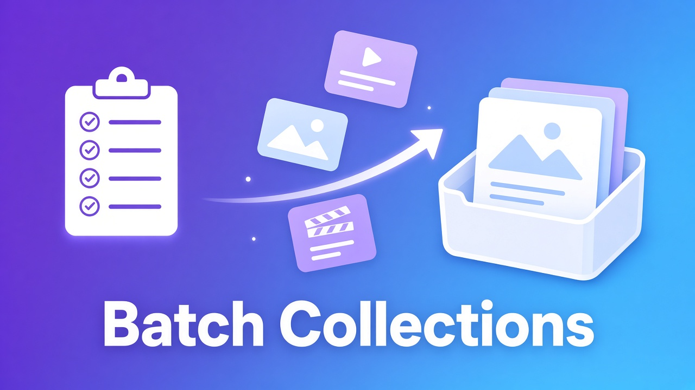
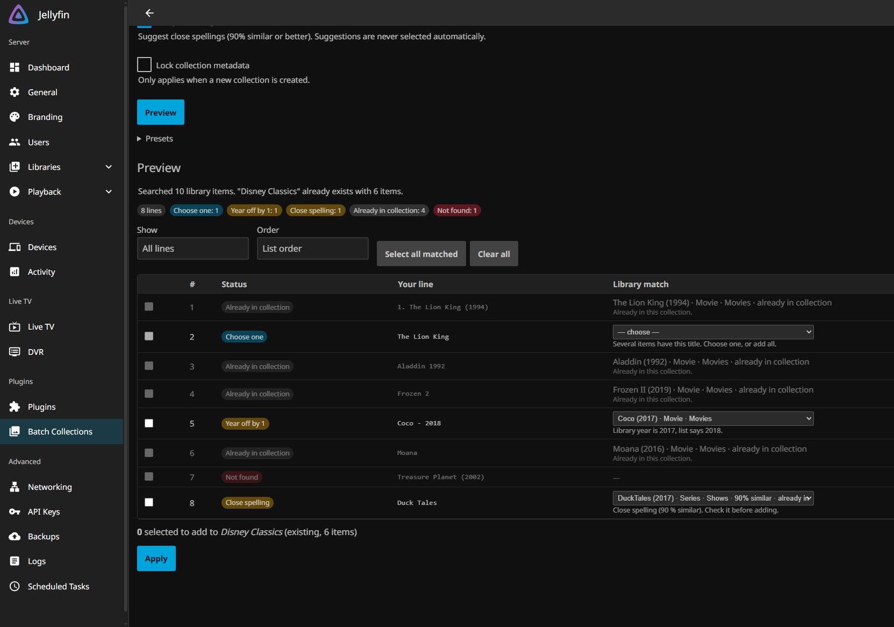
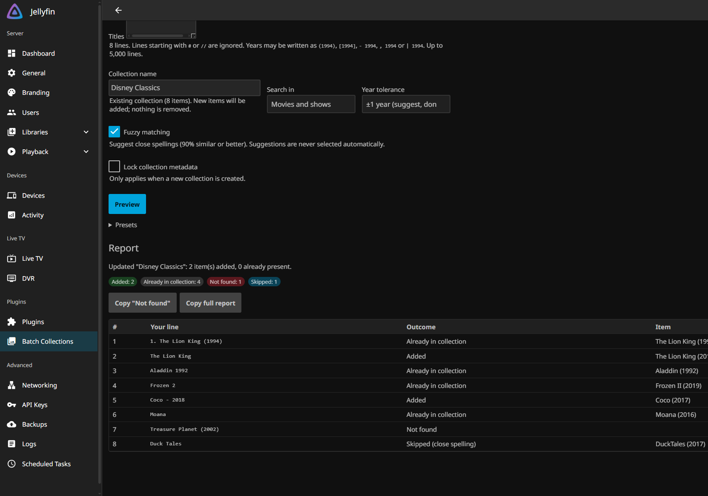

<p align="center">
  
</p>

<h1 align="center">Batch Collections for Jellyfin</h1>

<p align="center">
  Paste a list of movie or show titles. Get a collection.
</p>

<p align="center">
  
  
  <a href="https://github.com/xRaid3nx/JellyfinCollectionsPlugin/releases/latest"></a>
</p>

---

## What it does

Building a collection in Jellyfin normally means opening each movie and choosing *Add to collection*, one at a time. That's fine for five movies and painful for fifty.

**Batch Collections** lets you paste a whole list instead:

```text
The Lion King (1994)
Aladdin (1992)
Beauty and the Beast (1991)
Frozen 2
Moana
```

Type a collection name and click **Preview**. The plugin finds each title in your library and shows you what it found. Then click **Apply**, and every item you approved is added to the collection. If the collection doesn't exist yet, it's created for you.



### Why it's safe to use

- **Nothing changes until you click Apply.** Preview only looks.
- **It never removes anything.** It only creates collections and adds to them.
- **Unsure matches are never added automatically.** If a title could mean more than one thing (like *The Lion King* 1994 vs. 2019), you pick.
- **Running the same list again is harmless.** Items already in the collection are skipped.
- **It works offline.** It only looks at your own library and never contacts the internet.
- **Admins only.** Regular users can't see or use it.

## Install

You need **Jellyfin 12.2** and an administrator account.

1. In Jellyfin, open **Dashboard → Plugins → Repositories** (or *Manage Repositories*).
2. Click **+** (New Repository) and enter:
   - **Name:** `Batch Collections`
   - **URL:**
     ```text
     https://raw.githubusercontent.com/xRaid3nx/JellyfinCollectionsPlugin/main/manifest.json
     ```
3. Click **Save**.
4. Go to **Dashboard → Plugins → Catalog**, find **Batch Collections**, and click **Install**.
5. **Restart Jellyfin** (Dashboard → Restart, or restart the service/app).

### Open it

After the restart, go to **Dashboard**. **Batch Collections** appears in the left sidebar, in the *Plugins* section.

<details>
<summary>Manual install (without the repository)</summary>

1. Download the `.zip` from the [latest release](https://github.com/xRaid3nx/JellyfinCollectionsPlugin/releases/latest).
2. Create a folder named `Batch Collections_1.0.0.0` inside your Jellyfin `plugins` folder:
   - Windows: `%ProgramData%\Jellyfin\Server\plugins` (or `<data folder>\plugins` for a portable install)
   - Linux: `/var/lib/jellyfin/plugins`
   - Docker: `/config/plugins` (inside the container)
3. Extract `Jellyfin.Plugin.Collections.dll` into that folder.
4. Restart Jellyfin.

</details>

## How to use it

1. **Titles:** paste your list, one title per line. A year is optional but helps.
2. **Collection name:** type a new name, or pick an existing collection from the suggestions.
3. **Search in:** Movies and shows, Movies only, or Shows only.
4. Click **Preview** and check the results. Each line gets a coloured status:

   | Status | What it means | What to do |
   |---|---|---|
   | 🟢 **Matched** | Found exactly one item | Nothing, it's already ticked |
   | 🔵 **Choose one** | More than one item has this title | Pick the right one from the dropdown, or "Add all" |
   | 🟡 **Year off by 1** | Same title, but the year is one off | Tick it if it's the right movie |
   | 🟡 **Close spelling** | A very similar title was found | Tick it if it's the right movie |
   | 🟠 **Different year** | The title exists, but only with a different year | Check your list |
   | ⚪ **Already in collection** | It's already there | Nothing |
   | 🔴 **Not found** | Not in your library | Nothing, it will be listed in the report |

5. Click **Apply**. A report shows what was added. **Copy "Not found"** copies the missing titles, which makes a handy shopping list.



**Tip: presets.** Open **Presets** to save a list under a name. When you add more movies later, load the preset and apply it again; only the new ones get added.

### Writing your list

Lists copied from websites, spreadsheets, or notes usually work as-is. All of these are understood:

```text
The Lion King (1994)
The Lion King [1994]
The Lion King - 1994
Lion King, The
1. Aladdin
- Mulan
• Hercules
"Moana"
Frozen 2            ← also finds "Frozen II"
WALL-E              ← also finds "WALL·E"
# Lines starting with # are ignored
```

- Capital letters, accents, and punctuation don't matter.
- *The*, *A*, and *An* at the start don't matter.
- Numbers like *2*, *II*, and *Two* are treated the same.
- Up to 5,000 lines at a time.

## FAQ

**A movie I own says "Not found".**
Check how the title is spelled in Jellyfin (open the movie and look at its name), make sure **Search in** includes it, and make sure your library scan has finished. One known exception is *101 Dalmatians*, which doesn't match *One Hundred and One Dalmatians*. Use your library's spelling.

**I have two collections with the same name.**
The one with more items is used, and Preview shows a warning.

**What does "Lock collection metadata" do?**
It stops Jellyfin from overwriting the new collection's name and details during metadata refreshes. It only applies when a collection is created.

**Does this work with TV shows?**
Yes. Shows are added as whole series.

## Troubleshooting

- **I don't see it in the sidebar:** go to **Dashboard → Plugins → My Plugins** and check that Batch Collections is listed as *Active*. Restart Jellyfin if you just installed it.
- **The plugin shows "NotSupported" or "Malfunctioned":** your Jellyfin version doesn't match. This release is for Jellyfin 12.2.
- **Something went wrong:** open **Dashboard → Logs** and look for lines containing `Batch Collections:`. Please include them when you [open an issue](https://github.com/xRaid3nx/JellyfinCollectionsPlugin/issues).

## For developers

Building, testing, and releasing are covered in [docs/DEVELOPMENT.md](docs/DEVELOPMENT.md).

## License

[GPL-3.0](LICENSE). Not affiliated with the Jellyfin project.
